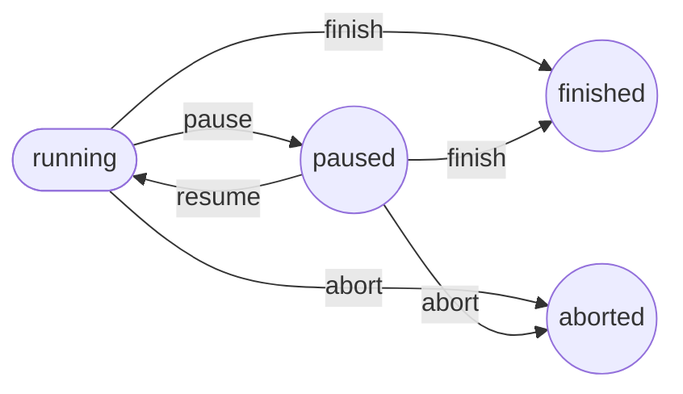

# Repcoach

[](https://github.com/Guiziweb/repcoach/actions/workflows/ci.yml)


An MCP server to log gym workouts from your AI assistant. You tell it what you did, it calls the tools, and the server keeps the numbers. Symfony, SQLite, and a small web app where the same coach drives the screens.

The model never does the maths. Volume, durations and dates come from tool results, so when the assistant says "you lifted 12 780 kg on Friday" it read that from the server.

Made for the Symfony AI & MCP Hackathon.

https://github.com/user-attachments/assets/f4dbae54-c4af-424a-8e93-7d48484a9d52

## Running it

You need PHP 8.4 or later with the SQLite and intl extensions, Composer and make. `make install` also downloads the JavaScript the web app uses.

```
make install
make migrate
make import
make fixtures
```

`make import` downloads the exercise list from RepDB (701 exercises, pinned version). `make fixtures` is optional: it loads three programs (Push, Pull, Legs) and 24 sessions spread over the last eight weeks, dated from the day you load them, so you have some history to play with. It wipes your own workouts and sessions, not the exercise list. Load it again later to bring the history back to the last few weeks. Everything is stored in `var/data_dev.db`.

Then connect an MCP client to it over stdio. It has been tried with Claude Desktop and Claude Code. Other clients that support MCP should work too, but they have not been tested.

### Claude Desktop

1. Quit the app.
2. Open its config file, `claude_desktop_config.json`. On macOS it is in `~/Library/Application Support/Claude/`.
3. Add the server, with the path to your copy of the project:

```json
{
  "mcpServers": {
    "repcoach": {
      "command": "php",
      "args": ["/absolute/path/to/this/project/bin/console", "mcp:server"]
    }
  }
}
```

4. Start the app again.

### Claude Code

```
cd /absolute/path/to/this/project
claude mcp add repcoach --scope user -- php "$(pwd)/bin/console" mcp:server
```

It works the same, but a terminal cannot draw charts of your progress, so a desktop client is the nicer place to use it.

### The web app

The web app shows your programs, your past sessions and the session in progress, with a coach next to the screen. You talk to it in a speech bubble; it calls the same tools as above and the screen follows what it does. Deleting, removing a set or aborting a session waits for you to press a button: the model alone cannot do it.

It needs an Anthropic API key, kept out of git in `.env.local`:

```
ANTHROPIC_API_KEY=sk-ant-...
```

`REPCOACH_MODEL` picks another model; it defaults to `claude-haiku-5-5`. Then run `make serve` and open http://127.0.0.1:8010. The interface follows the language of your browser, English or French, and the menu lets you switch. The coach answers in the language you write in.

## What you can ask

Talk to it in plain words, in any language. For example:

- "What was my last workout?"
- "Show me how my legs sessions progressed in a chart"
- "What did I do last week?"
- "Build me a back workout, I only have a pull-up bar"
- "Start my Push workout", then after each set "bench press, 8 reps at 60 kg", and "I'm done" at the end
- "Add a set of 10 squats at 80 kg to yesterday's session, I forgot it"
- "I forgot to stop my last session, it lasted 55 minutes"

## Tools

25 of them. Names are the ones the model sees.

**Exercises**

| Tool | What it does |
|---|---|
| `search_exercises` | Find exercises in the catalogue by name, muscle, body part, difficulty, equipment or bodyweight |

**Saved workouts**

| Tool | What it does |
|---|---|
| `list_workouts` | Every saved workout with its exercises |
| `show_workout` | One workout with the position of each line |
| `create_workout` | Save a new, empty workout |
| `plan_exercise` | Add an exercise with its sets, repetitions or seconds, and weight |
| `change_exercise` | Rewrite a planned line in place |
| `move_exercise` | Move a planned line to another position |
| `remove_exercise` | Drop a planned line |
| `rename_workout` | Give a workout another name |
| `duplicate_workout` | Copy a workout under a new name |
| `delete_workout` | Remove a workout, keeping the sessions already performed |

**Running a session**

| Tool | What it does |
|---|---|
| `start_session` | Open a session from a saved workout |
| `log_set` | Record a set, by its line in the plan or as an extra exercise |
| `current_session` | What has been done so far, and what is left |
| `pause_session` | Stop the clock |
| `resume_session` | Start the clock again |
| `finish_session` | Close the session and give its totals |
| `abort_session` | Close the session without counting it |

**History**

| Tool | What it does |
|---|---|
| `list_sessions` | Past sessions, one line each, filtered by workout, days or status |
| `show_session` | One session in full, with the id of each set |
| `update_session` | Correct when a session started or how long it lasted |
| `add_set` | Add a forgotten set to a session |
| `change_set` | Correct the repetitions, seconds or weight of a set |
| `remove_set` | Delete a set entered by mistake |
| `delete_session` | Delete a finished or aborted session with its sets |

**Prompts**

| Prompt | What it does |
|---|---|
| `coach_session` | Coach a session set by set, with the name of the workout completed as you type |
| `weekly_review` | Look back at the last seven days: what progressed, what stalled, what to do next |

## A few choices

A session copies the workout's plan when it starts, so editing the workout later doesn't change old sessions. Deleting a workout keeps the sessions already performed, under the name they were run with.

Inputs are checked with the Symfony Validator before anything is written. A refused call changes nothing, and the error says what to do next ("Use list_workouts to see them").

`list_sessions` only returns one line per session. The sets come from `show_session`. Otherwise a few months of history would fill the conversation.

A session is a Symfony Workflow state machine, and the server sets all the timestamps:



The code is split by domain (`Exercise`, `Workout`, `Session`, `Shared`), with one class per tool and one action per use case.

## Tests

`make ci` runs php-cs-fixer, the Symfony lints, PHPStan (max level) and PHPUnit. The browser tests drive Chromium through Playwright: install it once with `make browsers`, which needs Node.js 20 or later. One test talks to the server over HTTP, a transport only switched on in the test environment, and calls every tool once, so a tool added without a test fails the build. The tests never use the network.

## Credits

Exercise data by [RepDB](https://repdb.co). It is downloaded when you run `make import` and is not part of this repository.

Built with [Symfony](https://symfony.com), the [MCP bundle](https://github.com/symfony/ai) and the [MCP PHP SDK](https://github.com/modelcontextprotocol/php-sdk).

## Licence

MIT, see [LICENSE](LICENSE).
